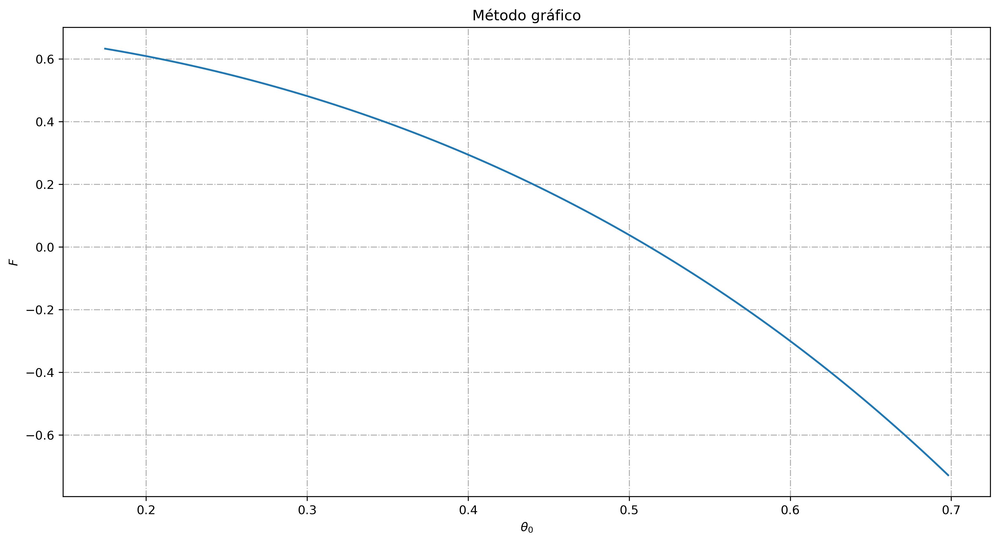
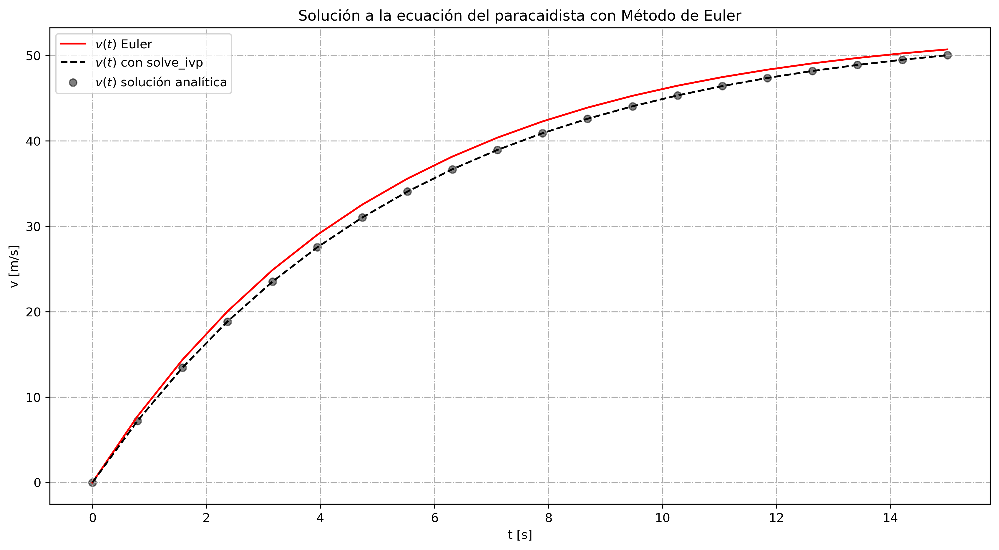
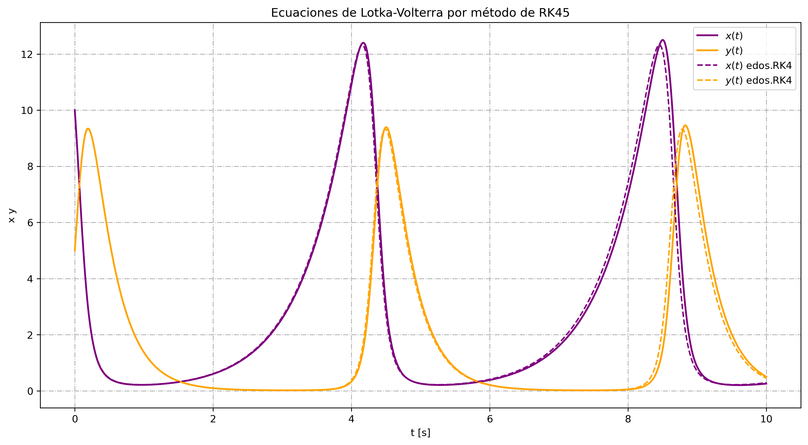

# Métodos Numéricos para Ingenieros en Python

Se utiliza el libro de Steven Chapra y Raymond Canale. 

Libro

[Numerical Methods for Engineers](https://www.amazon.com/Package-Numerical-Methods-Engineers-Semester/dp/1259289168/ref=sr_1_23?s=books&sr=1-23)

Los temas son:


- [Raíces de ecuaciones](#raíces-de-ecuaciones)
  - [Métodos Cerrados](#métodos-cerrados) 
    - [Método de la Bisección](#método-de-la-bisección)
- [Ecuaciones Algebraicas Lineales](#ecuaciones-algebraicas-lineales)
- [Optimización](#optimización)
- [Ajuste de Curvas](#ajuste-de-curvas)
- [Diferenciación e Integración Numérica](#diferenciación-e-integración-numérica)
- [Ecuaciones Diferenciales Ordinarias](#ecuaciones-diferenciales-ordinarias)
  - [Método de Euler](#método-de-euler)  
  - [Método de Heun](#método-de-heun)  
  - [Método de RK2](#método-de-rk2)  
  - [Método de RK4](#método-de-rk4)  
- [Ecuaciones Diferenciales Parciales](#ecuaciones-diferenciales-parciales)

## Raíces de ecuaciones

Supongamos el siguiente caso: se desea determinar las características del flujo alrededor
de una ojiva de misil. Cuando el misil alcanza velocidades supersónicas, el flujo (aire) produce cambios muy rápidos en las propiedades debido a este incremento de energía cinética.
Tales cambios tienen lugar sobre una distancia tan pequeña comparada con una dimensión
característica del movimiento que, desde el punto de vista de las aplicaciones prácticas, pueden ser consideradas como una verdadera discontinuidad. Estas discontinuidades, a través
de las cuales se produce una variación finita de las magnitudes físicas del movimiento, se
denominan ondas de choque. Estas discontinuidades se manifiestan en forma inclinada a
la dirección del flujo incidente y se denominan ondas de choques oblicuas. La
relación entre $V_1$, el ángulo de la ojiva $\theta$ y el ángulo de choque de la onda 
$\theta_0$ está dada por
la siguiente ecuación:

$$
\tan\theta = \frac{2(M_1^2\sin^2\theta_0 - 1)}{\tan\theta_0[M_1^2(\gamma + \cos2\theta_0) + 2]}
$$

Dicha expresión fue sacada del libro [Aplicaciones de la Dinámica de los Gases a Flujos Inestacionarios y Supersónicos](https://www.universitaseditorial.com.ar/productos/aplicacion-de-la-dinamica-de-los-gases-tamagno/). 

$M_1 = V_1/a$ es el número de Mach, siendo $a$ la velocidad del sonido. El valor de $\gamma$ se denomina coeficiente adiabático y para el aire tiene un valor de 1,4. Se deduce de esta
ecuación que si se conoce $\theta$ y la velocidad del flujo $V_1$ se puede determinar el ángulo que
forma la onda de choque. El problema de esta ecuación es que $\theta_0$ está implícita y no hay
forma de despejarla. Por lo tanto la única forma de resolver dicho problema es crear otra función de la forma $F(\theta_0)$ y aquel valor de $\theta_0$ tal que haga $F(\theta_0) = 0$ es la raíz al problema, es decir, el valor que se busca. 

### Métodos Cerrados
Éstos métodos se aprovechan del Teorema de Bolzano

>[!NOTE]
>
>Toda función continua en un intervalo que toma valores positivos y negativos se anula en algún punto de dicho intervalo. Es decir, sea un intervalo $I = [a, b]$ donde la función es continua y está definida en $I$, por lo tanto $\exist \ c \in I / f(c) = 0$.

#### Método de la Bisección
Una primera aproximación a la raíz son los métodos gráficos




Según la física detrás de las ondas de choque, los límites son $0^{\circ}$ (no existe onda de choque) y $90^{\circ}$ (onda de choque recto). Estos valores permiten definir un intervalo donde se encuentra la raíz de $F$ y los *métodos cerrados* son una muy buena opción para estos tipos de problemas. El siguiente código representa cómo implementar este método usando la función `raices.biseccion`

```
#velocidad de la ojiva en m/s
v1 = 850

#ángulo de la ojiva
th = np.deg2rad(15)

#Constante de los gases, coeficiente adiabático y temperatura
R = 287.05287 ; gamma = 1.4 ; T = 288.15

#Velocidad del sonido y Mach
a = np.sqrt(gamma*R*T)
M1 = v1/a

#Función
F = lambda x : np.tan(th) - 2*(M1**2*np.sin(x)**2 - 1)/(np.tan(th)*(M1**2*(gamma + np.cos(2*x)) + 2))
xl = np.deg2rad(10) ; xu = np.deg2rad(40)
x_malla = np.linspace(xl, xu, 100)


fig = plt.figure(figsize = (14, 7), dpi = 140)
plt.grid(linestyle = '-.')
plt.title('Método gráfico')
plt.xlabel(r'$\theta_0$')
plt.ylabel(r'$F$')

plt.plot(x_malla, F(x_malla))

cr, _ = biseccion(F, xl = xl, xu = xu)

#Verificación
if np.isclose(F(cr), 0):
    print(f'{cr} es la raíz de f')
```


## Ecuaciones Algebraicas Lineales

## Optimización

## Ajuste de Curvas

## Diferenciación e Integración Numérica

## Ecuaciones Diferenciales Ordinarias

Este capítulo se dedica a la solución de ecuaciones diferenciales ordinarias de la forma

$$
\frac{dy}{dx} = f(x, y)
$$

De la definición de diferencias finitas hacia adelante, podemos despejar $y_{i+1}$

$$
y_{i+1} = y_i + \frac{dy}{dx}(x_{i+1} - x_i)
$$

donde generalmente a $dy/dx$ se le denota con $\phi$ y $(x_{i+1} - x_i) = h$ es el paso. Existen varias formas de calcular $y_{i+1}$ pero las más conocidas son:

- Método de Euler
- Método de Heun
- Runge-Kutta de 2do orden
- Runge-Kutta de 4to orden


### Método de Euler
La primera derivada ofrece una estimación directa de la pendiente en $x_i$:

$$
\phi = f(x_i, y_i)
$$


donde $f(x_i, y_i)$ es la ecuación diferencial evaluada en $x_i$ y $y_i$. La estimación se sustituye en la ecuación:

$$
y_{i+1} = y_i + f(x_i, y_i)(x_{i+1} - x_i)
$$

Esta fórmula se conoce como **método de Euler**. Veamos un ejemplo:

$$
\frac{dv}{dt} = g - \frac{c}{m}v
$$

La solución analítica de esta ecuación diferencial es:

$$
v(t) = \frac{gm}{c}\left(1 - e^{-c/m \ t}\right)
$$




El código para realizar esto es llamar a la función `edos.euler`

```
from Metodos_Chapra.edos import euler
import matplotlib.pyplot as plt
import numpy as np
from scipy.integrate import solve_ivp
        
#Parámetros
g = 9.81 ; c = 12.5 ; m = 68.1

#Condición inicial
v0 = 0

#Intervalo de integración
t0 = 0 ; tf = 15
t_malla = np.linspace(t0, tf, 20)

#Ecuación diferencial lineal
dvdt = lambda t, v : g - c/m*v   

#Solución por Euler
vt = euler(dvdt, v0, t_malla)

#Por solve_ivp
vt_ivp = solve_ivp(dvdt, t_span = [t0, tf], y0 = [v0], t_eval = t_malla)
if vt_ivp.success:
    vt2 = vt_ivp.y.T
else:
    raise SystemExit(f'{vt_ivp.message}')
    
    
#Solución analítica
vt_real = lambda t : g*m/c*(1 - np.exp(-c/m*t))

#Ploteo
fig = plt.figure(figsize = (14, 7), dpi = 140)
plt.grid(linestyle = '-.')
plt.title('Solución a la ecuación del paracaidista con Método de Euler')
plt.xlabel(r't [s]')
plt.ylabel(r'v [m/s]')

plt.plot(t_malla, vt, color = 'red',label = r'$v(t)$ Euler')
plt.plot(t_malla, vt2, color = 'black', linestyle = '--',label = r'$v(t)$ con solve_ivp')
plt.scatter(t_malla, vt_real(t_malla), color = 'black', alpha = 0.5, label = r'$v(t)$ solución analítica')
```

Nótese que `euler` acepta 3 argumentos:

- `rhs` : Right Hand Side o lado derecho de la ecuación diferencial. Básicamente $f(t, v)$. A pesar de que la ecuación diferencial sea autónoma (no depende del parámetro $t$) se debe incluir el parámetro igual en la función `rhs`.
- `y0` : Condición inicial. 
- `t_eval` : Malla por donde se evalúa la solución.

### Método de Heun 

Un método para mejorar la estimación de la pendiente emplea la determinación de dos derivadas en el intervalo (una en el punto inicial y otra en el final). Las dos derivadas se promedian después con la finalidad de obtener una mejor estimación de la pendiente en todo el intervalo. 

La ecuación correctora es:

$$
y_{i+1} = y_i + \frac{f(x_i, y_i) + f(x_{i+1}, y_{i+1}^0)}{2}h
$$

donde $y_{i+1}^0 = y_i + f(x_i, y_i)h$. Veamos el ejemplo anterior pero aplicando la función `edos.heun`:


El código se realiza de la misma forma que el `euler` ya que los 3 argumentos se conservan.

### Método de Runge-Kutta de segundo orden

La versión de segundo orden de la familia de los métodos RK es:

$$
y_{i+1} = y_i + (a_1 k_1 + a_2 k_2)h
$$

La que se emplea en este repositorio es el **Método de Ralston** ($a_2 = 2/3$):

$$
y_{i+1} = y_i + \left(\frac{1}{3}k_1 + \frac{2}{3}k_2\right)h
$$

donde 

$$
k_1 = f(x_i, y_i)
$$

$$
k_2 = f\left(x_i + \frac{3}{4}h, y_i + \frac{3}{4}k_1h\right)
$$

Los argumentos a ingresar en la función `RK2` son los mismos que para `euler` y `heun`.

### Método de Runge-Kutta de cuarto orden

La forma comúnmente usada es:

$$
y_{i+1} = y_i + \frac{1}{6}(k_1 + 2k_2 + 2k_3 + k_4)h
$$

donde

$$
k_1 = f(x_i, y_i)
$$

$$
k_2 = f(x_i + \frac{1}{2}h, y_i + \frac{1}{2}k_1h)
$$

$$
k_3 = f(x_i + \frac{1}{2}h, y_i + \frac{1}{2}k_2h)
$$

$$
k_4 = f(x_i + h, y_i + k_3h)
$$

Veamos el siguiente ejemplo:

$$
\frac{dx}{dt} = Ax - Bxy
$$

$$
\frac{dy}{dt} = -Cy + Dxy
$$

Dichas ecuaciones son las de [Lotka-Volterra](https://es.wikipedia.org/wiki/Ecuaciones_de_Lotka-Volterra). Utilizamos la función `edo.RK4`




```
from Metodos_Chapra.edos import RK4
import matplotlib.pyplot as plt
import numpy as np
from scipy.integrate import solve_ivp


A = 1.5 ; B = 1 ; C = 3 ; D = 1
def lotka_volterra(t, S):
    x, y = S
    dx = A*x - B*x*y
    dy = -C*y + D*x*y
    
    dS = [dx, dy]
    return dS

lotka_volterra_sistema = [lambda t, x, y : A*x - B*x*y, lambda t, x, y : -C*y + D*x*y]

x0 = 10 ; y0 = 5
t0 = 0 ; tf = 10
n = 2000
t_malla = np.linspace(t0, tf, n)
metodo = 'RK45'

sol = solve_ivp(lotka_volterra, t_span = [t0, tf], y0 = [x0, y0], t_eval = t_malla, method = metodo)

#Por Euler
sol_e = euler_sistema(lotka_volterra_sistema, [x0, y0], t_malla)
xt_euler = sol_e[0] 
yt_euler = sol_e[1]

#Por RK45
sol_rk4 = RK4(lotka_volterra_sistema, [x0, y0], t_malla)
xt_rk4 = sol_rk4[0]
yt_rk4 = sol_rk4[1]

if sol.success:
    fig = plt.figure(figsize = (14, 7), dpi = 140)
    plt.grid(linestyle = '-.')
    plt.xlabel('t [s]')
    plt.ylabel('x y')
    plt.title(f'Ecuaciones de Lotka-Volterra por método de {metodo}')
    
    xt = sol.y[0]
    yt = sol.y[1]
    t = sol.t
    
    #Solución por solve_ivp con método RK45
    plt.plot(t, xt, color = 'purple', linewidth = 1.8, label = r'$x(t)$')
    plt.plot(t, yt, color = 'orange', linewidth = 1.8, label = r'$y(t)$')
    
    #Por mi RK45
    plt.plot(t, xt_rk4, color = 'purple', linewidth = 1.5, label = r'$x(t)$ edos.RK4', linestyle = '--')
    plt.plot(t, yt_rk4, color = 'orange', linewidth = 1.5, label = r'$y(t)$ edos.RK4', linestyle = '--')
    
    
    
    plt.legend()
```

Se observa la diferencia entre el método empleado por `solve_ivp` y `RK4`. `solve_ivp` utiliza el método de Runge-Kutta 4(5) o método de Dormand-Prince, que pertenece a la familia de RK pero adaptativo, es decir, tienen *control adaptativo del tamaño de paso*. En cambio, `RK4` utiliza un paso constante, por eso la diferencia al final de la figura.


## Ecuaciones Diferenciales Parciales