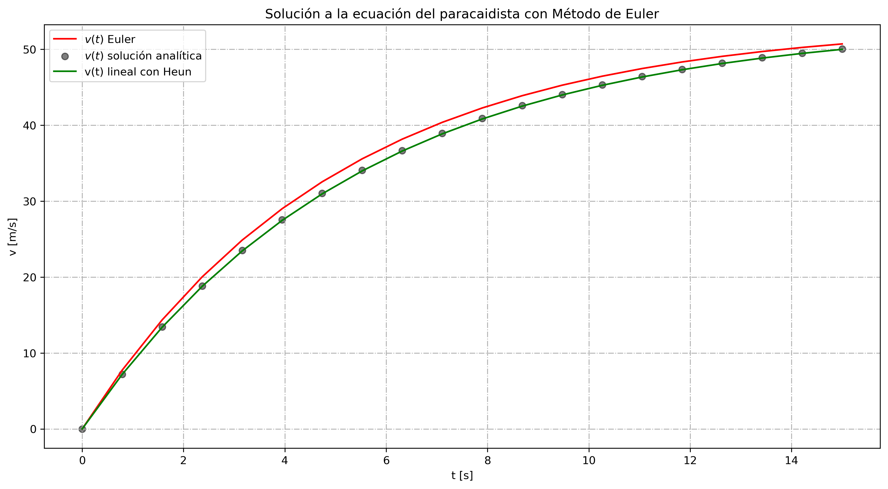

# Métodos Numéricos para Ingenieros en Python

Se utiliza el libro de Steven Chapra y Raymond Canale. 

Libro

[Numerical Methods for Engineers](https://www.amazon.com/Package-Numerical-Methods-Engineers-Semester/dp/1259289168/ref=sr_1_23?s=books&sr=1-23)

Los temas son:

1. [Raíces de ecuaciones](#raíces-de-ecuaciones)
2. [Ecuaciones Algebraicas Lineales](#ecuaciones-algebraicas-lineales)
3. [Optimización](#optimización)
4. [Ajuste de Curvas](#ajuste-de-curvas)
5. [Diferenciación e Integración Numérica](#diferenciación-e-integración-numérica)
6. [Ecuaciones Diferenciales Ordinarias](#ecuaciones-diferenciales-ordinarias)
7. [Ecuaciones Diferenciales Parciales](#ecuaciones-diferenciales-parciales)

## Raíces de ecuaciones

## Ecuaciones Algebraicas Lineales

## Optimización

## Ajuste de Curvas

## Diferenciación e Integración Numérica

## Ecuaciones Diferenciales Ordinarias

Este capítulo se dedica a la solución de ecuaciones diferenciales ordinarias de la forma

$$
\frac{dy}{dx} = f(x, y)
$$

De la definición de diferencias finitas hacia adelante, podemos despejar $y_{i+1}$

$$
y_{i+1} = y_i + \frac{dy}{dx}(x_{i+1} - x_i)
$$

donde generalmente a $dy/dx$ se le denota con $\phi$ y $(x_{i+1} - x_i) = h$ es el paso. Existen varias formas de calcular $y_{i+1}$ pero las más conocidas son:

- Método de Euler
- Método de Heun
- Runge-Kutta de 2do orden
- Runge-Kutta de 4to orden


### Método de Euler
La primera derivada ofrece una estimación directa de la pendiente en $x_i$:

$$
\phi = f(x_i, y_i)
$$


donde $f(x_i, y_i)$ es la ecuación diferencial evaluada en $x_i$ y $y_i$. La estimación se sustituye en la ecuación:

$$
y_{i+1} = y_i + f(x_i, y_i)(x_{i+1} - x_i)
$$

Esta fórmula se conoce como **método de Euler**. Veamos un ejemplo:

$$
\frac{dv}{dt} = g - \frac{c}{m}v
$$

La solución analítica de esta ecuación diferencial es:

$$
v(t) = \frac{gm}{c}\left(1 - e^{-c/m \ t}\right)
$$


El código para realizar esto es llamar a la función `edos.euler`

```
from Metodos_Chapra.edos import euler
import matplotlib.pyplot as plt
import numpy as np
from scipy.integrate import solve_ivp
        
#Parámetros
g = 9.81 ; c = 12.5 ; m = 68.1

#Condición inicial
v0 = 0

#Intervalo de integración
t0 = 0 ; tf = 15
t_malla = np.linspace(t0, tf, 20)

#Ecuación diferencial lineal
dvdt = lambda t, v : g - c/m*v   

#Solución por Euler
vt = euler(dvdt, v0, t_malla)

#Por solve_ivp
vt_ivp = solve_ivp(dvdt, t_span = [t0, tf], y0 = [v0], t_eval = t_malla)
if vt_ivp.success:
    vt2 = vt_ivp.y.T
else:
    raise SystemExit(f'{vt_ivp.message}')
    
    
#Solución analítica
vt_real = lambda t : g*m/c*(1 - np.exp(-c/m*t))

#Ploteo
fig = plt.figure(figsize = (14, 7), dpi = 140)
plt.grid(linestyle = '-.')
plt.title('Solución a la ecuación del paracaidista con Método de Euler')
plt.xlabel(r't [s]')
plt.ylabel(r'v [m/s]')

plt.plot(t_malla, vt, color = 'red',label = r'$v(t)$ Euler')
plt.plot(t_malla, vt2, color = 'black', linestyle = '--',label = r'$v(t)$ con solve_ivp')
plt.scatter(t_malla, vt_real(t_malla), color = 'black', alpha = 0.5, label = r'$v(t)$ solución analítica')
```

Nótese que `euler` acepta 3 argumentos:

- `rhs` : Right Hand Side o lado derecho de la ecuación diferencial. Básicamente $f(t, v)$. A pesar de que la ecuación diferencial sea autónoma (no depende del parámetro $t$) se debe incluir el parámetro igual en la función `rhs`.
- `y0` : Condición inicial. 
- `t_eval` : Malla por donde se evalúa la solución.

### Método de Heun 

Un método para mejorar la estimación de la pendiente emplea la determinación de dos derivadas en el intervalo (una en el punto inicial y otra en el final). Las dos derivadas se promedian después con la finalidad de obtener una mejor estimación de la pendiente en todo el intervalo. 

La ecuación correctora es:

$$
y_{i+1} = y_i + \frac{f(x_i, y_i) + f(x_{i+1}, y_{i+1}^0)}{2}h
$$

donde $y_{i+1}^0 = y_i + f(x_i, y_i)h$. Veamos el ejemplo anterior pero aplicando la función `edos.heun`:



El código se realiza de la misma forma que el `euler` ya que los 3 argumentos se conservan.

### Método de Runke-Kutta de segundo orden

La versión de segundo orden de la familia de los métodos RK es:

$$
y_{i+1} = y_i + (a_1 k_1 + a_2 k_2)h
$$

La que se emplea en este repositorio es el **Método de Ralston** ($a_2 = 2/3$):

$$
y_{i+1} = y_i + \left(\frac{1}{3}k_1 + \frac{2}{3}k_2\right)h
$$

donde 

$$
k_1 = f(x_i, y_i)
$$

$$
k_2 = f\left(x_i + \frac{3}{4}h, y_i + \frac{3}{4}k_1h\right)
$$

Los argumentos a ingresar en la función `RK2` son los mismos que para `euler` y `heun`.


## Ecuaciones Diferenciales Parciales